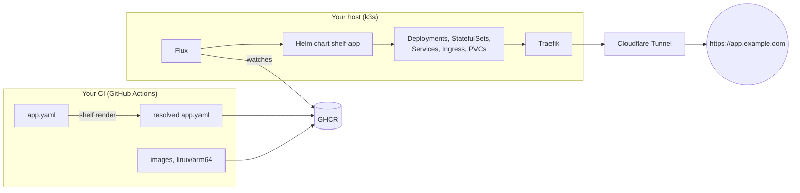

# shelf

**Build and verify on your hardware, ship to any cloud, with the same verified artefact.**

shelf is a self-hosted GitOps platform for developers who let several coding agents work in
parallel. It runs on any Linux host with k3s, or with one command on a Mac (Colima). The goal is
that every branch gets its own isolated preview, only verified artefacts become reachable beyond
it, and the same verified state reaches any Kubernetes cloud as a pull request, without depending
on shelf.

Describe your app in one short `app.yaml`, build your images in your own CI, and shelf runs
them on Kubernetes: with persistent volumes, generated secrets and health checks. An app stays
inside the cluster until you give it a public address: `https://<app>.<your-domain>` through
your own Cloudflare account, or a temporary `*.trycloudflare.com` name that needs no account.

> [!WARNING]
> shelf is a learning and reference project for platform engineering, and it is
> **pre-production**: production is a separate cluster reached through eject (planned). It is
> **still under construction**: today a push to your repository deploys your app, and the CLI or
> an admin UI in the browser adds, changes and removes apps. Branch previews, the verification
> chain, the host setup, the installer and eject are planned, not built. See [Status](#status).

Where this is going: you run Claude Code (other agents later) in several worktrees at once. Every
branch your agents push gets its own preview of the complete stack, database included, in a
namespace of its own, reachable from your machine with `shelf app open` and from nowhere else.
Your agents push, wait for the rollout and read a machine-readable verdict. Only an artefact that
CI signed and scanned can be put on the internet, and the operator decides that, never the
repository. When an app is ready, `shelf eject` hands the same verified digest to your production
cluster as a pull request of plain Flux and Helm objects. shelf is for developers who are
willing to see Kubernetes; the cluster stays open to `kubectl`.

## Contents

- [Why shelf](#why-shelf)
- [How it works](#how-it-works)
- [Status](#status)
- [Quick start](#quick-start)
- [Deploying an app](#deploying-an-app)
- [Writing an `app.yaml`](#writing-an-appyaml)
- [What shelf does in the cluster](#what-shelf-does-in-the-cluster)
- [CLI reference](#cli-reference)
- [Developing shelf](#developing-shelf)
- [Further reading](#further-reading)
- [License](#license)

## Why shelf

Running a few side projects on a machine at home usually means handwritten Kubernetes
manifests, or a pile of `docker run` commands. shelf sits in between:

- **One file per app.** Components, ports, routes, volumes and secrets go in a single
  `app.yaml`. shelf turns it into Deployments, StatefulSets, Services, Ingresses and PVCs.
- **Your CI stays yours.** Your pipeline builds the images and pushes them to GitHub Container
  Registry (GHCR). shelf never talks to Git or to your forge: the registry is the only
  interface.
- **Secrets never show up in manifests.** Passwords are generated on the platform and
  referenced as `${secrets.db-password}`.
- **Standard building blocks.** Flux, Helm, Traefik and Cloudflare Tunnel do the heavy lifting.
  shelf is mostly glue.
- **Apps are isolated.** Each app gets its own namespace, and nothing is shared between apps.

## How it works



1. Your workflow builds the images and runs `shelf render` on your `app.yaml`. This pins every
   image to a digest, fills in host names and ports, and checks your file.
2. It pushes the result to GHCR as a small deploy artifact.
3. Flux on your host notices the new artifact and hands it to the generic `shelf-app` Helm
   chart, which creates the Kubernetes objects.
4. Traefik routes requests by host name. An app you put on the internet gets a Cloudflare
   Tunnel of its own, with cloudflared in its namespace, so no port on the host is opened.

What shelf does is specified in [openspec/specs/](openspec/specs); the roadmap and the work in
progress are the changes in [openspec/changes/](openspec/changes).

## Status

shelf is built in phases. After each phase the maintainer reviews the result before the next
one starts.

| Phase | Content | State |
|---|---|---|
| 0 | Devcontainer, local k3d cluster, smoke tests | ✅ done |
| 1 | `app.yaml` schema, `shelf validate`, `shelf render`, CI | ✅ done |
| 0b | Switch the devcontainer to Docker-in-Docker | ✅ done |
| 2 | Helm chart `shelf-app` | ✅ done |
| 3 | `shelf init cluster`: Flux, Traefik | ✅ done |
| 4 | Delivery: deploy artifact, `shelf app add` / `rm`, reusable workflow | ✅ done |
| 4b | `build:` in `app.yaml`, release binaries, tenant repo without image names | ✅ done |
| 5 | `shelf init expose`: Cloudflare Tunnel, DNS | ✅ done, replaced by 8b |
| 6 | Operations layer shared by the CLI and the admin UI | ✅ done |
| 7 | `shelf serve`: admin UI with login and dashboard | ✅ done |
| 8 | Adding, changing and removing apps from the browser | ✅ done |
| 8b | Connections instead of platform credentials: registry logins and Cloudflare accounts chosen per app, one tunnel per app | ✅ done |
| 8d | Apps stay inside the cluster by default, quick tunnels, no cluster domain | ✅ done |
| 9 | Agent interface: `--json`, `shelf app status --wait`, `shelf app open` | ✅ done |
| 10 | Branch previews: one isolated preview per branch, discovered from the registry | planned |
| 11 | Verification chain: signatures, scans, provenance; exposure only for verified digests | planned |
| 12 | Hardening: Pod Security, NetworkPolicies, smoke tests per preview | planned |
| 13 | Host: macOS with Colima and Linux with k3s, `shelf doctor`, `shelf destroy` | planned |
| 14 | Service and one-command installer | planned |
| 15 | Logs, resource usage, self-update | planned |
| 16 | Eject and promotion to a production cluster | planned |

Phases 6 to 13 were re-cut on 2026-09-20, when the target product changed from a command-line
tool to an appliance with an admin UI. On 2026-10-27 the roadmap was re-cut again: shelf became
a platform for parallel agent branches, the previews and the verification chain moved ahead of
the host setup, the Mac lock-in was dropped, and the setup wizard was deferred. Every phase from here on is an
[OpenSpec](https://github.com/Fission-AI/OpenSpec) change in [openspec/changes/](openspec/changes);
the decisions and results of Phases 0 to 8d, with their reasons, are in
[the baseline archive](openspec/changes/archive/2026-10-20-baseline).

## Quick start

> [!NOTE]
> On the finished product this becomes one command on the host —
> `curl -fsSL https://raw.githubusercontent.com/tweinmann/shelf/v0/install.sh | sh`. That
> installer arrives in Phase 14. Until then, install the binary yourself:

Download the latest release for your platform (linux or darwin, amd64 or arm64):

```sh
curl -fsSL -o shelf.tar.gz \
  https://github.com/tweinmann/shelf/releases/latest/download/shelf_darwin_arm64.tar.gz
tar -xzf shelf.tar.gz && sudo install shelf /usr/local/bin/shelf
```

Or build it from source (Go 1.27 or later):

```sh
git clone https://github.com/tweinmann/shelf.git
cd shelf
go build -o bin/shelf ./cmd/shelf
```

Check the example app. `validate` works offline:

```console
$ shelf validate examples/hello/app.yaml
examples/hello/app.yaml: valid
```

Render it. This looks up the images in their registries:

```console
$ shelf render -o app examples/hello/app.yaml
apiVersion: shelf.dev/v1alpha1
name: hello
components:
  db:
    image: postgres:16@sha256:f1c3376c…
    ports:
      main: 5432
    ...

App hello (namespace hello):
  check  Deployment × 1   postgres:16@sha256:f1c3376c…
  db     StatefulSet × 1  postgres:16@sha256:f1c3376c…
         Service db       main=5432
         PVC data-db-0    1Gi at /var/lib/postgresql/data
  web    Deployment × 2   traefik/whoami:v1.11.0@sha256:20068979…
         Service web      main=80
         Route            / → port main
  secret db-password (generated) → env SHELF_SECRET_DB_PASSWORD
```

The manifest goes to stdout and the summary to stderr, so you can redirect the manifest to a
file.

## Deploying an app

Your repository needs two files. In `app.yaml`, a component you build yourself points at its
directory instead of an image:

```yaml
components:
  web:
    build: ./web          # directory with the Dockerfile
    port: 8080
    route: /
```

The second file is the same for every app:

```yaml
# .github/workflows/deploy.yml
on:
  push:
    branches: [main]
  pull_request:
permissions:
  contents: read
  packages: write
jobs:
  shelf:
    uses: tweinmann/shelf/.github/workflows/build.yml@v0
```

The workflow builds every `build` directory for `linux/arm64`, pushes the images, pins them to
their digests, and publishes the deploy artifact. Everything lives under the package name, which
is `name` in `app.yaml`: the artifact is `ghcr.io/<owner>/<name>`, an image is
`ghcr.io/<owner>/<name>/<component>`.
Image names never appear in `app.yaml`. Ready-made images such as `postgres:16` stay as `image:`.
[examples/tenant](examples/tenant) is a complete example repository.

Once per cluster, install the platform:

```sh
shelf init cluster
```

Once per GitHub account, define a registry connection, so the cluster can pull private images
and artifacts. Use a classic personal access token with `read:packages`; a fine-grained token
cannot pull. The token is read from the environment only, never from a flag:

```sh
GHCR_USERNAME=<you> GHCR_TOKEN=<token> shelf connection add registry ghcr
```

Once per app, add it. shelf generates the app's secrets and keeps a backup in
`~/.shelf/apps/<app>/secrets.yaml`:

```sh
shelf app add <app> oci://ghcr.io/<owner>/<name>:main --registry ghcr
```

`<app>` is yours to choose and need not match the package: it becomes the app's namespace. The
same artifact can be added under several names, for instance `shop` and `shop-staging`; each
gets a namespace and secrets of its own. A public artifact needs no `--registry`.

The app now answers at `<app>.shelf.internal`, inside the cluster only. To look at it from a
browser on your machine, without putting it anywhere else:

```sh
shelf app open <app> --browser
```

To reach it from the internet, choose one of two ways:

- **Your own domain** through your Cloudflare account. Define the connection once; the token
  needs Account:Cloudflare Tunnel:Edit and Zone:DNS:Edit, and stays on your machine in
  `~/.shelf/connections/cloudflare/`, never in the cluster:

  ```sh
  CF_API_TOKEN=<token> shelf connection add cloudflare home
  shelf app add <app> oci://ghcr.io/<owner>/<name>:main --cloudflare home --domain example.com
  ```

  The app gets its own tunnel and a DNS record, and answers at `https://<app>.example.com`.
- **A quick tunnel** with `--quick`: no account, no domain, a random
  `https://<words>.trycloudflare.com` name that `shelf app status` shows. The name **changes
  whenever cloudflared restarts**, anyone who has it can reach the app, and Cloudflare offers
  it for trying things out only.

`shelf app credentials <app>` changes the connections or the domain later, and `--private`
takes the app off the internet again.

From then on, every push to `main` reaches the cluster by itself, usually within two minutes.
A coding agent working in the repository waits for its own commit with
`shelf app status <app> --wait --commit "$(git rev-parse HEAD)" --json` and reads the verdict
(see [Output for scripts and agents](#output-for-scripts-and-agents));
[examples/tenant](examples/tenant) ships a Claude Code skill and a `CLAUDE.md` that explain the
loop.
`shelf app rm <app>` removes the app with all its data, its tunnel and its DNS record.

## Writing an `app.yaml`

A complete example with a web frontend, an API and a Postgres database:

```yaml
# yaml-language-server: $schema=https://raw.githubusercontent.com/tweinmann/shelf/main/schema/app.schema.json
apiVersion: shelf.dev/v1alpha1
name: shop                       # the package name: ghcr.io/<owner>/shop

components:
  web:
    image: ghcr.io/you/shop-web:1.4.0
    port: 8080
    route: /                     # reachable from outside
    instances: 2
    health: { path: /healthz }
    resources: { cpu: 500m, memory: 512Mi }

  api:
    image: ghcr.io/you/shop-api:1.4.0
    port: 3000
    route: /api
    env:
      DATABASE_URL: postgres://app:${secrets.db-password}@${db.host}:${db.port}/shop
    volumes:
      uploads: { path: /data/uploads, size: 5Gi }

  db:
    image: postgres:16
    port: 5432                   # no route: only reachable inside the app
    env:
      POSTGRES_USER: app
      POSTGRES_PASSWORD: ${secrets.db-password}
      POSTGRES_DB: shop
      PGDATA: /var/lib/postgresql/data/pgdata
    volumes:
      data: { path: /var/lib/postgresql/data, size: 20Gi }

secrets:
  db-password: { generate: true }
```

The first line gives you autocompletion and inline checks in VS Code (with the YAML extension)
and other editors that support JSON Schema. `shelf schema` prints the same schema.

### Component fields

| Field | Meaning |
|---|---|
| `image` | A ready-made image, e.g. `postgres:16`. `shelf render` pins tags to a digest. The image must provide `linux/arm64`. |
| `build` | A directory of this repository with a Dockerfile, e.g. `./web`. Your CI builds and pushes it. Use either `image` or `build`. |
| `command`, `args` | Override the image's entrypoint and command, as in Kubernetes. |
| `env` | Environment variables as a map. Numbers and booleans are fine (`PORT: 8080`). |
| `port` | The single port the container listens on. |
| `ports` | Several named ports, e.g. `{ http: 8080, metrics: 9100 }`. Use either `port` or `ports`. |
| `route` | Makes the component reachable from outside: `route: /api`, or `route: { path: /api, port: http, stripPrefix: true }`. The long form is required when the component has several ports. |
| `instances` | Number of replicas, default 1. Replicas do not form a cluster; that is up to your app. |
| `volumes` | Persistent volumes: `name: { path, size }`. A component with volumes runs as a StatefulSet. |
| `health` | HTTP probe: `{ path, port?, initialDelay? }`, with `initialDelay` in seconds. It tells Kubernetes (and your deploy) when the component is ready. |
| `resources` | `{ cpu, memory }` requests. Memory is also the hard limit, which protects the other apps on the machine. |

### References

Inside `env`, `command` and `args` you can use:

| Reference | Becomes |
|---|---|
| `${db.host}` | the host name of component `db` |
| `${db.port}` | its port, if it has exactly one |
| `${api.ports.metrics}` | a named port |
| `${secrets.db-password}` | the secret value, injected at runtime; it never appears in any manifest |

`$` works like in docker compose: `$$` is a literal `$`, and a `$` that is not followed by `{`
stays as it is. So `sh -c 'echo $HOME'` works without escaping.

### Things to know

- **Volume sizes are not enforced.** The local storage on the host does not limit
  capacity, so `size` is documentation. A component can fill the disk.
- **Plan volumes up front.** Kubernetes does not allow changing the volumes of a StatefulSet in
  place, and the local storage cannot grow, so changing an existing volume later needs manual
  steps. Giving a component its first volumes, or removing all of them, works: the component
  restarts, and `${<component>.host}` keeps pointing at it. **Removing volumes deletes their
  data.**
- **Names:** app and component names use lowercase letters, digits and `-`, and are at most
  40 characters long. `secrets`, `app` and `shelf` are reserved component names, and component
  names must not end with `-headless`.
- **Secrets:** only generated secrets (`generate: true`) are supported for now. Generated
  values are URL-safe, so you can put them into connection strings as they are.
- **A host suffix** such as `--host-suffix -dev` separates two clusters that share a DNS zone:
  an app with a domain then answers at `<app>-dev.<domain>`. A new suffix renames every app
  that has a domain, so `shelf init cluster` refuses it while such apps exist. With
  `--move-hosts` it goes ahead and lists the DNS records that stay behind under the old names,
  so you can delete them. Apps without a domain are not affected.

## What shelf does in the cluster

You never have to look, but nothing is hidden. shelf keeps the substrate reachable with
`kubectl`, and the split of ownership is this:

- **`shelf-system`** holds the registrations and the `ResourceSet` `apps` that turns each one
  into a running app. Per app, shelf writes a `ResourceSetInputProvider` (the app's
  registration), the Secret `app-<app>` with its generated secret values and, for an app with
  its own tunnel, `tunnel-<app>` with the tunnel's credentials. Registry connections are the
  Secrets `connection-registry-<name>`; `registry-anonymous` is what an app without one pulls
  with.
- **`flux-system`** and **`traefik`** hold Flux and Traefik. They and the `ResourceSet` belong
  to Flux and come from a released platform artifact. **Editing them by hand does not last**;
  Flux reverts the change at the next reconciliation.
- **One namespace per app**, named after the app, holds everything that app runs, including its
  cloudflared if it is on the internet. That is yours.

Cloudflare tokens never enter the cluster; they stay in `~/.shelf/connections/cloudflare/` on
the machine that runs shelf.

So: look at anything, change the app namespaces if you must, and leave the platform to Flux. If
you want a different platform, change it in the repository and release it, not in the cluster.

## CLI reference

The command line is the expert interface. From Phase 7 on, everything below is also available in
the admin UI, and both go through the same code — there is no second implementation that could
drift.

| Command | What it does |
|---|---|
| `shelf validate <app.yaml>...` | Checks one or more files without network access. Errors and warnings show file, line and field. Exits with 1 on errors. |
| `shelf render <app.yaml>` | Validates, resolves images and prints the deploy manifest (a ConfigMap). `-o app` prints the resolved `app.yaml` instead. `--image <component>=<reference>` supplies the image of a component with a `build` directory. Registry credentials come from `docker login`. |
| `shelf schema` | Prints the JSON Schema for `app.yaml`. |
| `shelf build-plan <app.yaml>` | Prints the package name (`name` in `app.yaml`) and the components with a `build` directory as JSON. The workflow uses it to name the packages and to know what to build. |
| `shelf init cluster` | Installs Flux and the platform (Traefik, app management) into the cluster of the current kubecontext, and waits until everything is ready. `--host-suffix -dev` separates clusters that share a DNS zone: apps with a domain are then reachable at `<app>-dev.<domain>`. Shows the target cluster and asks before changing anything (`--yes` skips the question); `--context` and `--kubeconfig` pick another cluster. Safe to run again. |
| `shelf connection add registry <name>` | Defines a registry login for `ghcr.io` from `GHCR_USERNAME` and `GHCR_TOKEN`. It is stored in the cluster and copied only into the namespaces of the apps that chose it. |
| `shelf connection add cloudflare <name>` | Defines a Cloudflare account from `CF_API_TOKEN` (and `CF_ACCOUNT_ID` when the token sees several). shelf checks the token and keeps it in `~/.shelf/connections/cloudflare/`, never in the cluster. |
| `shelf connection list` / `rm <kind> <name>` | Lists the connections and the apps that use them; removes one no app uses. |
| `shelf connection packages <name>` / `zones <name>` | Lists the deploy artifacts a registry connection can pull, or the zones of a Cloudflare connection's account. |
| `shelf app add <app> <oci://…:tag>` | Deploys an app from a deploy artifact under the name `<app>` and keeps it updated. The name is independent of the package, so one artifact can be added under several names. `--registry` picks the registry connection; `--cloudflare` with `--domain` puts the app on the internet under its own domain, `--quick` through a quick tunnel; without either it stays inside the cluster. Generates the app's secrets, stores them in the cluster and in `~/.shelf/apps/<app>/secrets.yaml`, and restores them from there after a cluster rebuild. Refuses at once if the cluster has no platform. Waits until the app is ready. Safe to run again, e.g. after adding a secret. |
| `shelf app credentials <app>` | Changes the app's connections or domain and deploys it again: `--registry`, `--no-registry`, `--cloudflare`, `--domain`, `--quick`, `--private`. |
| `shelf app open <app>` | Makes the app reachable from a browser on this machine at `http://127.0.0.1:<port>/`, for as long as it runs: requests go through the Kubernetes API server to the cluster's Traefik with the app's own Host header, so routes and `stripPrefix` behave as through a tunnel. Works for apps that stay inside the cluster. Listens on 127.0.0.1 only; `--port` picks the port, `--browser` opens it. It is not an exposure and changes nothing about the app. |
| `shelf app tags <app>` | Lists the tags of the app's deploy artifact, newest first. |
| `shelf app redeploy <app>` | Fetches the app's artifact again under the tag it is registered with and rolls out what it finds. For a tag that moved, or a deploy worth another try. |
| `shelf app secrets <app>` | Lists the names of the generated secrets; `--reveal` prints the values. |
| `shelf app status [app]` | Lists the apps with their state, or walks one app from its deploy artifact to its running pods and says which step is not ready. For one app it also shows the git commit the running artifact was built from, and names its components and where each of them answers. Same chain as the admin UI shows. `--wait` waits until the app is Ready or a step failed and prints the verdict; `--commit <sha>` first waits until the app runs the artifact built from that commit. Exit status 0 Ready, 1 failed, 2 timed out (`--timeout`, default 10m). |
| `shelf serve` | Runs the admin UI on port 7654 of the local network (`--listen 127.0.0.1:7654` keeps it off the network). The first start prints a setup code that claims the instance; after that a password protects it. |
| `shelf app rm <app>` | Removes an app with its namespace, volumes, secrets, tunnel and DNS record, after asking. The secret backup stays. |
| `shelf version` | Prints the version. |

### Output for scripts and agents

`shelf app status`, `shelf app tags`, `shelf connection list` and `shelf version` take `--json`
and then print one JSON document on stdout and nothing else there:

```console
$ shelf app status hello --json
{
  "apiVersion": "shelf.dev/v1alpha1",
  "kind": "AppStatus",
  "name": "hello",
  "phase": "Ready",
  "artifact": "oci://ghcr.io/o/hello:main",
  "commit": "42a964eb0b4bd7248305d5f22233d6dbabcd56f3",
  "stages": [ ... ],
  ...
}
```

Every document has `apiVersion` and `kind` (`AppList`, `AppStatus`, `WaitResult`, `TagList`,
`ConnectionList`, `Version`). A command that fails prints a document of kind `Error` with a
`message`, and exits with status 1. Within one `apiVersion`, no field is removed, renamed or
given another meaning; new fields may appear, so ignore the ones you do not know. Empty fields
are left out rather than `null`. `shelf app secrets` has no `--json`, so that secret values never
end up in an agent's transcript.

An agent that pushed a commit waits for it like this:

```console
$ shelf app status hello --wait --commit "$(git rev-parse HEAD)"
hello: Failed, running commit 42a964eb0b4b
  the pods: ImagePullBackOff: Back-off pulling image
  the image cannot be pulled; check the reference and whether the cluster may read that registry
$ echo $?
1
```

The wait reads the commit from the deploy artifact the cluster holds, which the reusable workflow
stamps with the commit it was built from, and is Ready only once every step has caught up with
that artifact. It never changes anything: the platform notices a new artifact within a minute
by itself. With `--json` the verdict is a `WaitResult` with `outcome` (`Ready`, `Failed` or
`TimedOut`) and, unless Ready, the `stage` that holds the app up, with its `reason`, `message`
and `hint`.

Example of an error message:

```text
app.yaml:12: error: components.web.route: route needs a port; add port or ports to the component
```

`shelf service`, which installs the admin UI as a background service, and the commands for the
host (`shelf init host`, `shelf doctor`, `shelf destroy`) follow in later phases.

## Developing shelf

All development happens in a [devcontainer](https://containers.dev). On your machine you only
need Docker Desktop and VS Code with the Dev Containers extension. Every tool version is pinned
in [.devcontainer/Dockerfile](.devcontainer/Dockerfile).

The devcontainer runs its own Docker daemon (Docker-in-Docker, which makes it a privileged
container), and the local Kubernetes cluster runs inside it. Your other Docker containers stay
out of reach.

1. Open the repository in VS Code and choose **Reopen in Container**.
2. Run the checks, the same ones CI runs:

   ```sh
   just test
   ```

Useful commands:

| Command | Purpose |
|---|---|
| `just test` | Formatting, `go vet`, unit tests, chart lint and golden files, manifest validation, examples, OpenSpec specs |
| `just golden` | Rewrite golden files and `schema/app.schema.json` after an intended change |
| `just build` | Build `bin/shelf` |
| `just cluster-up` / `cluster-stop` / `cluster-down` / `cluster-reset` | Manage the local k3d cluster `shelf-dev` |
| `just platform-push`, `just chart-push`, `just init-cluster` | Push `platform/` and the chart to the local registry; `init-cluster` pushes both and installs them with `shelf init cluster` |
| `just smoke-secrets`, `just smoke-chart`, `just smoke-init`, `just smoke-apps`, `just smoke-agent` | Smoke tests against the local cluster, also run in CI: secret expansion, the chart, `shelf init cluster` with routing through Traefik, `shelf app add`/`rm` with rollouts from the local registry, and the agent interface (`--json`, `--wait --commit`, `shelf app open`) |
| `just smoke-registry <image>`, `just smoke-tenant <app> <artifact>`, `just smoke-expose <app> <domain>` | Smoke tests that need credentials: a private image pull, a real tenant repository end to end, and an app's own Cloudflare tunnel (needs a cluster with a host suffix) |
| `just smoke-quick` | A quick tunnel for `examples/hello`; puts it on the internet for a few minutes |
| `hack/nuke.sh` | **Run in a terminal on your machine, not in the container.** Removes every Docker object shelf created. |

Changes to shelf go through [OpenSpec](https://github.com/Fission-AI/OpenSpec): the behaviour
is described in [openspec/specs/](openspec/specs), and a change starts as a proposal in
[openspec/changes/](openspec/changes). [CLAUDE.md](CLAUDE.md) has the workflow.

On your machine's Docker daemon, shelf only creates the devcontainer with its image and
volumes, as listed in the spec [dev-environment](openspec/specs/dev-environment/spec.md).
`hack/nuke.sh` removes exactly those, by name. The cluster disappears with them.

Repository layout:

```text
LICENSE, NOTICE     Apache-2.0, and what shelf redistributes
cmd/shelf/          CLI entry point
internal/           schema, validation, rendering, cluster installation, CLI
charts/shelf-app/   the generic Helm chart every app is installed with
platform/           what Flux installs into every cluster (Traefik, the app ResourceSet)
schema/             generated JSON Schema for app.yaml
examples/hello/     reference app
examples/tenant/    example tenant repository (app.yaml, image, workflow)
.github/workflows/  CI, and build.yml, the reusable workflow for tenants
hack/               dev cluster, platform push, smoke tests, cleanup
openspec/           specs, the change of each phase, the archive of finished ones (OpenSpec)
```

## Further reading

- [openspec/config.yaml](openspec/config.yaml): the project context and architecture in short
- [openspec/changes/archive/2026-10-20-baseline](openspec/changes/archive/2026-10-20-baseline):
  every decision before OpenSpec with its reasons, and the results of Phases 0 to 8d
- [openspec/specs/](openspec/specs): what shelf does, as requirements and scenarios per
  capability
- [CLAUDE.md](CLAUDE.md): working agreements for AI-assisted development in this repository

## License

[Apache License 2.0](LICENSE). shelf redistributes the installation manifest of the
[Flux Operator](https://github.com/controlplaneio-fluxcd/flux-operator) (Apache-2.0); see
[NOTICE](NOTICE).
